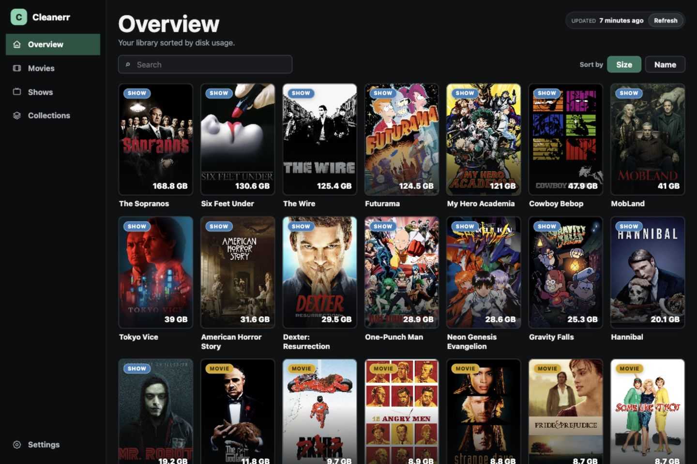

# Cleanerr

Cleanerr is a small web application for reviewing the disk space used by a
Radarr and Sonarr library. It can sort movies, series, seasons, and Radarr
collections by size and perform monitoring or deletion actions from one place.



> [!WARNING]
> Some actions delete media files from disk through Radarr or Sonarr. Review
> every confirmation carefully. Cleanerr does not provide an undo function.

## How it works

Configure the URLs and API keys for your Radarr and Sonarr instances in
Settings. Each service has separate **Test connection** and **Save** actions.
Leave an API key field empty to keep the saved value for the same server URL.
Enter a key when changing the URL. Use the final service URL: authenticated
requests do not follow redirects. Jellyfin is optional;
when configured, Cleanerr asks it to refresh its library after deleting media.

Browse movies, series, seasons and collections, sort them by size, and review
monitoring or deletion actions before confirming. Failed writes are not
automatically retried: check Radarr or Sonarr before repeating an action.
Deleting a collection's movies removes its movies and files and unmonitors the
collection; the collection itself remains in Radarr.

## Docker Compose

Copy or download [docker-compose.yml](docker-compose.yml) into a directory.
It uses the published image `ghcr.io/aitorperezzz/cleanerr:latest`.
From that directory, start the app or update it to the latest published image:

```sh
docker compose up -d --pull always
```

Open <http://localhost:3050>. A new installation opens Settings to configure
your services. Radarr and Sonarr must be reachable from the container.
Change the left side of `3050:3050` to use a different host port.
You only need the Compose file; cloning the repository is optional.

Settings persist in the `cleanerr-data` volume at `/data/config.json`.
Service URLs and API keys are created at runtime and are never stored in the
image. Anyone who can access Settings can replace the service configuration,
so place Cleanerr behind the same access controls as your media services.
Do not commit settings or expose API keys in screenshots or logs.

Stop the app with `docker compose down`; the settings volume is preserved.

## Run locally

With Node.js 26 and npm installed, clone the repository and run:

```sh
npm ci
npm start
```

Open <http://localhost:3050>. Local settings are stored in `data/config.json`,
which is excluded from Git and the Docker build context. Installing `curl`
is recommended as a fallback when Node.js cannot complete library reads.
The server listens on `0.0.0.0:3050`, as defined in [config.json](config.json).

Run `npm test` to check the code. Tests use fake service responses and do not
connect to real Radarr, Sonarr or Jellyfin instances.

## GitLab CI/CD

Every branch push builds with Buildah and publishes the commit SHA and `latest`
to the local GitLab registry. Only pushes to the default branch (`main` or
`master`) also publish `ghcr.io/aitorperezzz/cleanerr:latest`. Tag pushes and
merge request pipelines do not publish images.

Set `GHCR_TOKEN` as a masked and hidden GitLab CI/CD variable, with expansion
disabled, using a GitHub classic token with `write:packages`. If the variable
is protected, protect the default branch too. After the first publication,
set the GitHub package to **Public** to allow pulls without authentication.
